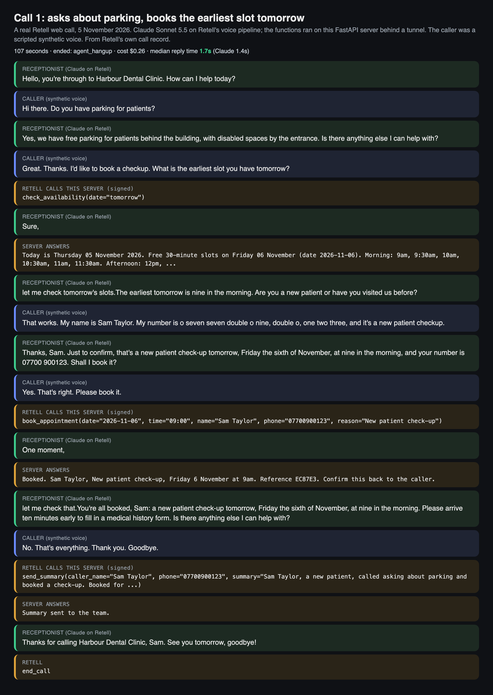
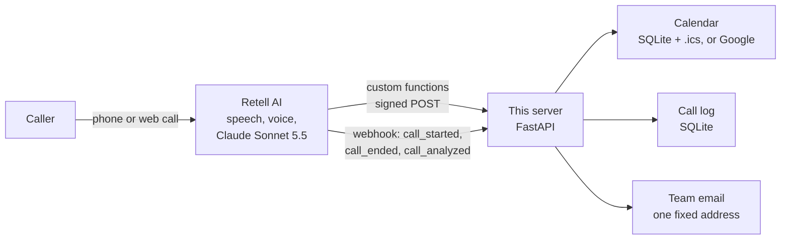
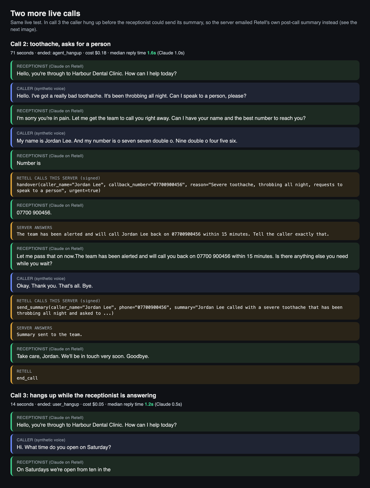
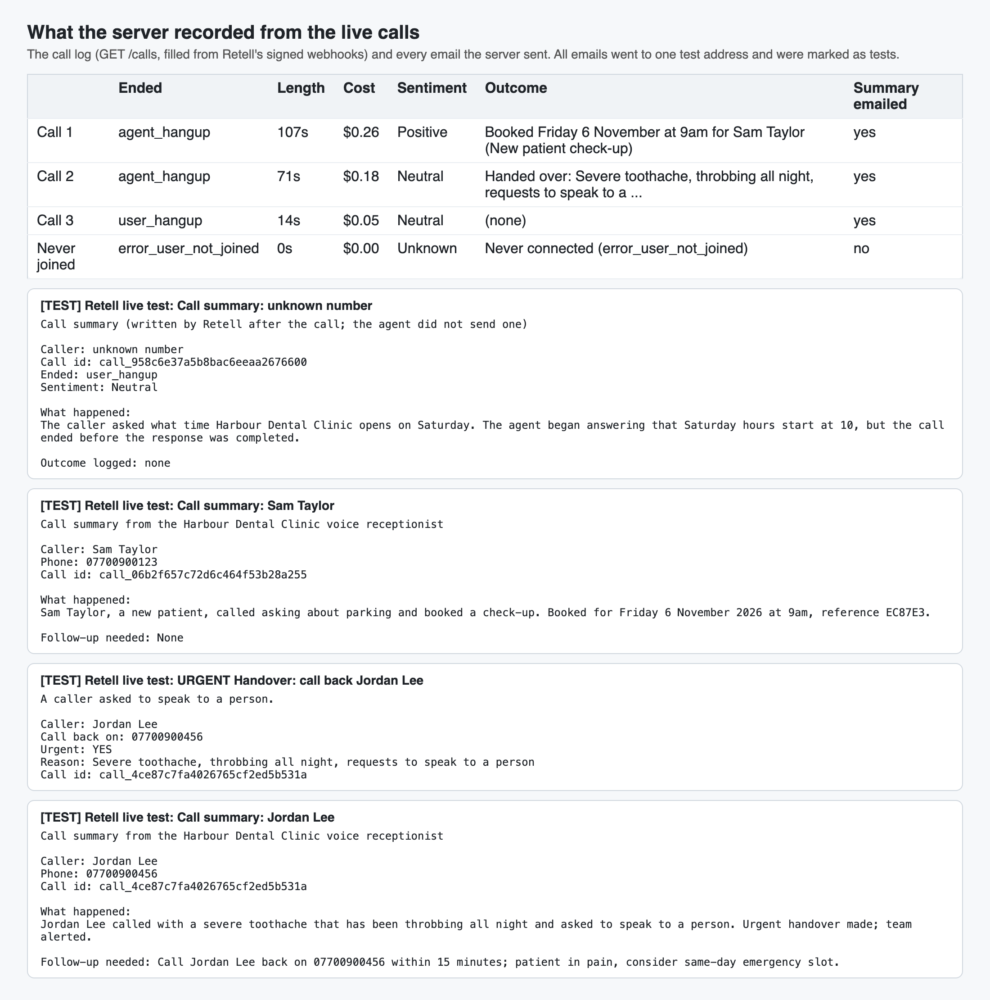

# Retell AI Receptionist

A phone receptionist built on **Retell AI**, with Claude (Sonnet 5.5) as the brain. It answers questions from a knowledge base, checks real availability, books appointments into a calendar, hands urgent callers to a person, and emails the team a summary of every call. Retell handles the phone line, speech and voice; this repo is the small FastAPI server Retell calls during the call, plus a script that creates the Retell LLM and agent through Retell's API.

It is a Retell version of my [Vapi receptionist](https://github.com/ParishSynthMind/voice-ai-receptionist): the same booking, calendar and call-log logic, rewired to Retell's custom functions, webhooks and signatures.



*A real Retell web call, 5 November 2026, taken from Retell's own call record. Claude Sonnet 5.5 ran on Retell's voice pipeline and the functions ran on this server. The caller was a scripted synthetic voice (see [Tested live](#tested-live-on-5-november-2026)).*

## How it works



1. **Retell runs the call.** `scripts/create_agent.py` creates a Retell LLM (prompt with the knowledge base, Claude via `model_config`, four custom functions and Retell's `end_call`) and an agent that uses it, with this server as its webhook.
2. **Mid-call, Retell calls the functions.** Each one is its own URL, `POST /retell/tool/<name>`, with Retell's body `{"name", "call", "args"}`:
   - `check_availability`: real free slots from the calendar, morning and afternoon, and today's date so the model never guesses it.
   - `book_appointment`: books only a slot that is still free, refuses a double booking in plain words, returns a short reference.
   - `handover`: emails the team to call the person back (marked URGENT if they are in pain) and tells the caller when to expect it.
   - `send_summary`: emails the team a two-line summary and any follow-up.
   The answer is a short sentence the agent can speak.
3. **After the call, Retell sends webhooks.** `call_ended` writes the transcript, end reason, duration and cost to the call log; `call_analyzed` adds Retell's own summary and the caller's sentiment. If the agent never sent a summary (the caller hung up early, say), Retell's summary is emailed instead, once, so no call goes unreported.

## Security and reliability

- **Every request from Retell is verified.** `X-Retell-Signature` is `v=<ms timestamp>,d=<hex>`, an HMAC-SHA256 of the raw body plus the timestamp, keyed with the Retell API key. The server checks it on the raw bytes (never re-serialised JSON), refuses timestamps more than 5 minutes off (no replays), and compares in constant time. Missing, wrong or stale signature: 401. No API key configured: 503, unless `ALLOW_UNSIGNED=1` is set for local development. Retell's documented sending IP (`100.20.5.228`) can also be allowlisted at the firewall.
- **The model can't choose who gets email.** Summaries and handovers go to one address from the config (`TEAM_EMAIL`, which must be a single address). Nothing a caller says and nothing in a tool call can change the recipient.
- **Webhook retries are handled once.** Retell retries a webhook up to 3 times if it doesn't get a 2xx within 10 seconds; each `(call, event)` is processed once and repeats just get a 204.
- **Bookings are never retried by Retell** (`max_retry: 0`), because Retell's docs warn a retry repeats the request.
- **No caller details in the server log.** Names and numbers stay in the call log database; the log line only says which function ran.
- **Admin views are closed by default.** `/calls` and `/calendar.ics` need `Authorization: Bearer <ADMIN_TOKEN>`.
- **Caller text is cleaned** (control characters stripped, lengths capped) before it reaches a calendar or an email, and the prompt treats what callers say as information, not instructions.
- **A broken calendar doesn't mean silence.** Any unexpected error gives the agent a sentence to say ("I couldn't reach the booking system, let me take a message") and is logged against the call.

## Run it

```bash
python -m venv .venv && source .venv/bin/activate
pip install -r requirements.txt -r requirements-dev.txt
cp .env.example .env                 # then fill it in; never commit it

uvicorn receptionist.main:app --port 8000
# Retell only calls public https URLs, so expose it (for example with a Cloudflare or ngrok tunnel)

python scripts/create_agent.py --server-url https://your-tunnel.example.com --dry-run   # see both bodies
python scripts/create_agent.py --server-url https://your-tunnel.example.com            # create LLM + agent
python scripts/create_agent.py --server-url https://new-url.example.com --update        # after changes
python scripts/create_agent.py --delete                                                 # remove both
```

Then call the agent from the Retell dashboard ("Test" with your browser's microphone) or a Retell phone number.

### A live call without a microphone

```bash
mkdir -p clips/booking
say -o /tmp/01.aiff "Hi there. Do you have parking for patients?" && afconvert -f WAVE -d LEI16@48000 /tmp/01.aiff clips/booking/01.wav
python scripts/web_test_call.py --clips clips/booking --out runs/booking --keychain retell-api-key
```

`web_test_call.py` starts a real Retell web call in a headless browser and plays the caller lines instead of a microphone, waiting for the receptionist to stop talking before each one (`--hangup-early` hangs up mid-answer). Retell now issues web-call tokens for its "gateway" transport, so the page uses `retell-client-js-sdk` 3.x and passes `transport` and `call_id` from `create-web-call`; the 2.x SDK fails with "invalid API key".

### Without a Retell account

```bash
RETELL_API_KEY=local-test-key uvicorn receptionist.main:app --port 8000
RETELL_API_KEY=local-test-key python scripts/simulate_call.py
```

`simulate_call.py` plays one call against the server the way Retell would, with real signatures. Its output from 5 November 2026 is in [`examples/local-run/`](examples/local-run/).

### Google Calendar

`CALENDAR_BACKEND=google` with a service account that the calendar is shared with ("Make changes to events"). The Google backend is the one from the Vapi build, where it was tested live against a real Google Calendar.

## Tests

```bash
pytest          # 68 tests, Retell, Google Calendar and email mocked, no keys needed
ruff check .
```

- **Signatures** against an independent computation of Retell's documented scheme, plus changed bodies, wrong keys, stale and future timestamps, and malformed headers.
- **The server as Retell sees it**: signed function calls in Retell's request shape (and the "args only" shape), every function, double booking, a name that doesn't match the URL, bad JSON, the full webhook lifecycle, retries, the fallback summary email, admin access, and that the log holds no caller details.
- **The LLM and agent bodies** checked against the rules in Retell's API reference (required fields, tool name pattern, timeout and retry ranges, `model_config` instead of the deprecated `model`, a model id from Retell's list).
- **Retell's REST API** mocked at the HTTP layer with its documented paths, status codes (201 create, 204 delete, 422) and `{"status": "error", "message": ...}` bodies, including 429 "Account rate limited" retried then reported; and the create, update and delete script end to end.
- The scheduling, calendar and booking tests carried over from the Vapi build.

GitHub Actions runs lint and tests on every push, with no secrets.

## Tested live on 5 November 2026

The server ran on this Mac behind a Cloudflare quick tunnel, `create_agent.py` created the LLM and agent through Retell's API (first try, no changes needed), and three real Retell web calls were made with a synthetic caller. Emails went over real SMTP to one test address. Evidence in [`examples/live-run/`](examples/live-run/). The agent and LLM were deleted afterwards.

| Call | What the caller did | What happened |
|---|---|---|
| 1 | Asked about parking, then the earliest slot tomorrow | Parking answered from the knowledge base; `check_availability` found 9am; details read back; `book_appointment` booked it (in `/calendar.ics`); `send_summary` emailed once. 107 s, $0.26. |
| 2 | Toothache, asked for a person | `handover` with `urgent: true`, the URGENT email sent, the caller told "within 15 minutes"; summary emailed. 71 s, $0.18. |
| 3 | Hung up while the receptionist was answering | `user_hangup` after 14 s; Retell's own summary emailed once by the fallback. $0.05. |

- **Every Retell request passed the signature check**: 23 of 23 (function calls and webhooks from Retell's documented IP `100.20.5.228`). An unsigned and a forged request sent through the tunnel got 401, and `/calls` without the admin token got 401.
- **Median reply time 1.2 to 1.7 seconds** end to end (Claude 0.5 to 1.4 s), from Retell's latency figures.
- **Webhooks arrive out of order** (on call 3, `call_analyzed` came before `call_ended` and `call_started`). The call log merged them correctly.
- **The live run found one thing, fixed with tests and re-checked live**: Retell sends `call_ended` and `call_analyzed` even for a web call whose caller never joined (`error_user_not_joined`), and the fallback emailed an empty "summary" for each. Those calls are now logged as "Never connected" with no email, and a web call's fallback says "web call" instead of "unknown number" (call 3's email above predates that change).
- **68 tests pass** and lint is clean; the earlier signed local run is still in [`examples/local-run/`](examples/local-run/).





## What is NOT proven

- **A real phone line.** The calls were Retell web calls (the same agent, voice pipeline and functions), not calls to a Retell phone number, so phone-network audio and caller ID were not tested.
- **A human caller.** The caller was a synthetic voice reading a script. Retell transcribed it well (it wrote the phone numbers as "o seven seven double o", and Claude still got them right).
- **Many calls or calls at the same time.** Three calls, one at a time.
- **Call transfer to a real number**, SMS, and a real phone number on the agent. Not built here (the handover emails the team instead).
- **The Google Calendar backend on this build.** It is the Vapi build's, tested live there; these calls used the local calendar.

## Project layout

```
receptionist/
  app.py          FastAPI: /retell/tool/{name}, /retell/webhook, /calls, /calendar.ics, /health
  signature.py    X-Retell-Signature check (and signing, for tests and the simulator)
  agent.py        the Retell LLM and agent request bodies (prompt, tools, model)
  retell_api.py   small Retell REST client (create, update, delete, web call, get call)
  tools.py        the four functions; each returns a sentence the agent can say
  scheduling.py   opening hours -> free slots; "tomorrow", "friday" -> dates
  calendar/       local SQLite + .ics, and Google Calendar
  calllog.py      calls, function calls and webhook deliveries in SQLite
  notify.py       SMTP, or a local outbox file when no SMTP is set
scripts/
  create_agent.py   create / update / delete the LLM and agent through Retell's API
  simulate_call.py  play a signed call against a running server, no Retell account needed
  web_test_call.py  a real Retell web call with a synthetic caller, no microphone needed
  render_media.py   README images from the live run
data/knowledge_base.md   the (fictional) clinic's FAQ, swap for a real client's
```

## Licence

MIT. Built by [ParishSynthMind](https://github.com/ParishSynthMind).
