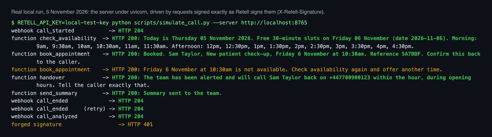
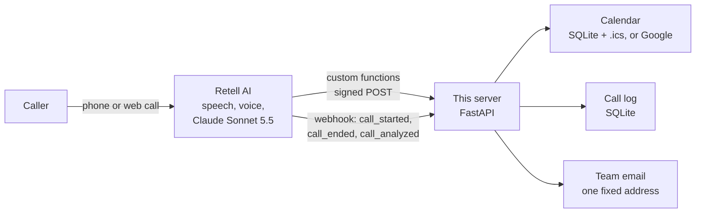
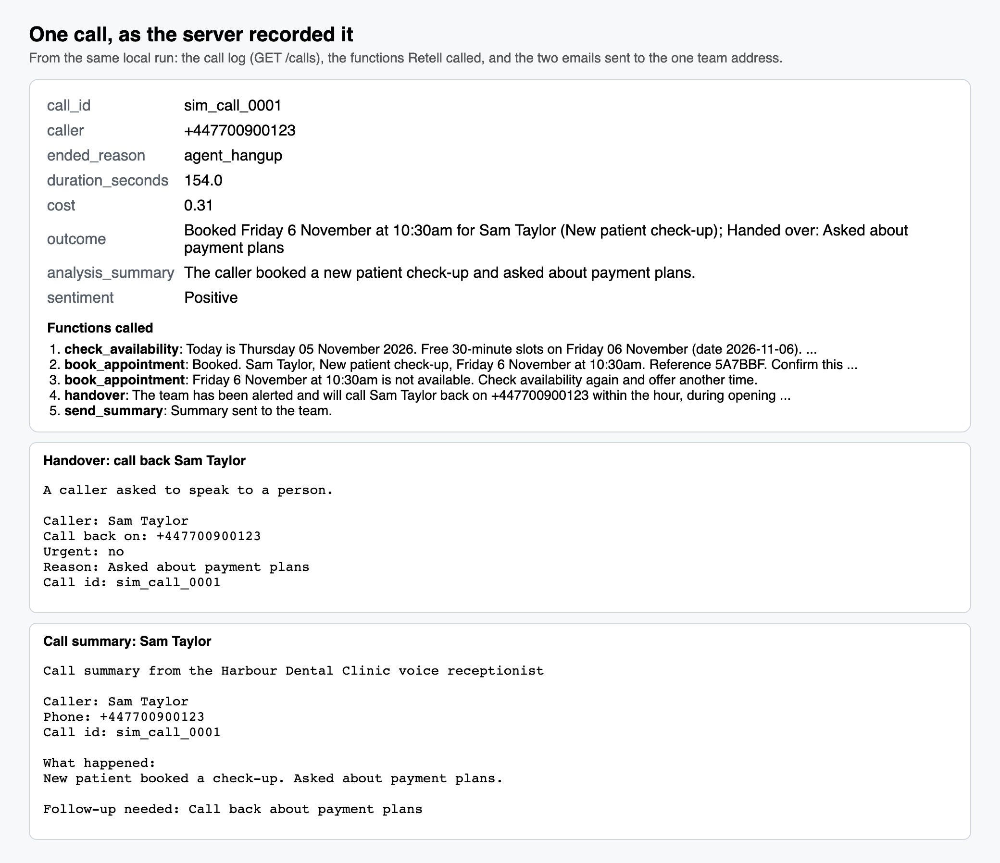

# Retell AI Receptionist

A phone receptionist built on **Retell AI**, with Claude (Sonnet 5.5) as the brain. It answers questions from a knowledge base, checks real availability, books appointments into a calendar, hands urgent callers to a person, and emails the team a summary of every call. Retell handles the phone line, speech and voice; this repo is the small FastAPI server Retell calls during the call, plus a script that creates the Retell LLM and agent through Retell's API.

It is a Retell version of my [Vapi receptionist](https://github.com/ParishSynthMind/voice-ai-receptionist): the same booking, calendar and call-log logic, rewired to Retell's custom functions, webhooks and signatures.



*Real local run, 5 November 2026. The server ran under uvicorn and a simulator sent each request exactly as Retell's docs describe them, signed with `X-Retell-Signature`. A second caller trying the booked slot was refused, Retell's retry of `call_ended` was ignored, and a request with a forged signature got a 401. This is not a live Retell call yet; see [What is NOT proven](#what-is-not-proven).*

## How it works



1. **Retell runs the call.** `scripts/create_agent.py` creates a Retell LLM (prompt with the knowledge base, Claude via `model_config`, four custom functions and Retell's `end_call`) and an agent that uses it, with this server as its webhook.
2. **Mid-call, Retell calls the functions.** Each one is its own URL, `POST /retell/tool/<name>`, with Retell's body `{"name", "call", "args"}`:
   - `check_availability`: real free slots from the calendar, morning and afternoon, and today's date so the model never guesses it.
   - `book_appointment`: books only a slot that is still free, refuses a double booking in plain words, returns a short reference.
   - `handover`: emails the team to call the person back (marked URGENT if they are in pain) and tells the caller when to expect it.
   - `send_summary`: emails the team a two-line summary and any follow-up.
   The answer is a short sentence the agent can speak.
3. **After the call, Retell sends webhooks.** `call_ended` writes the transcript, end reason, duration and cost to the call log; `call_analyzed` adds Retell's own summary and the caller's sentiment. If the agent never sent a summary (the caller hung up early, say), Retell's summary is emailed instead, once, so no call goes unreported.

## Security and reliability

- **Every request from Retell is verified.** `X-Retell-Signature` is `v=<ms timestamp>,d=<hex>`, an HMAC-SHA256 of the raw body plus the timestamp, keyed with the Retell API key. The server checks it on the raw bytes (never re-serialised JSON), refuses timestamps more than 5 minutes off (no replays), and compares in constant time. Missing, wrong or stale signature: 401. No API key configured: 503, unless `ALLOW_UNSIGNED=1` is set for local development. Retell's documented sending IP (`100.20.5.228`) can also be allowlisted at the firewall.
- **The model can't choose who gets email.** Summaries and handovers go to one address from the config (`TEAM_EMAIL`, which must be a single address). Nothing a caller says and nothing in a tool call can change the recipient.
- **Webhook retries are handled once.** Retell retries a webhook up to 3 times if it doesn't get a 2xx within 10 seconds; each `(call, event)` is processed once and repeats just get a 204.
- **Bookings are never retried by Retell** (`max_retry: 0`), because Retell's docs warn a retry repeats the request.
- **No caller details in the server log.** Names and numbers stay in the call log database; the log line only says which function ran.
- **Admin views are closed by default.** `/calls` and `/calendar.ics` need `Authorization: Bearer <ADMIN_TOKEN>`.
- **Caller text is cleaned** (control characters stripped, lengths capped) before it reaches a calendar or an email, and the prompt treats what callers say as information, not instructions.
- **A broken calendar doesn't mean silence.** Any unexpected error gives the agent a sentence to say ("I couldn't reach the booking system, let me take a message") and is logged against the call.

## Run it

```bash
python -m venv .venv && source .venv/bin/activate
pip install -r requirements.txt -r requirements-dev.txt
cp .env.example .env                 # then fill it in; never commit it

uvicorn receptionist.main:app --port 8000
# Retell only calls public https URLs, so expose it (for example with a Cloudflare or ngrok tunnel)

python scripts/create_agent.py --server-url https://your-tunnel.example.com --dry-run   # see both bodies
python scripts/create_agent.py --server-url https://your-tunnel.example.com            # create LLM + agent
python scripts/create_agent.py --server-url https://new-url.example.com --update        # after changes
python scripts/create_agent.py --delete                                                 # remove both
```

Then call the agent from the Retell dashboard ("Test" with your browser's microphone) or a Retell phone number.

### Without a Retell account

```bash
RETELL_API_KEY=local-test-key uvicorn receptionist.main:app --port 8000
RETELL_API_KEY=local-test-key python scripts/simulate_call.py
```

`simulate_call.py` plays one call against the server the way Retell would, with real signatures. Its output from 5 November 2026 is in [`examples/local-run/`](examples/local-run/).

### Google Calendar

`CALENDAR_BACKEND=google` with a service account that the calendar is shared with ("Make changes to events"). The Google backend is the one from the Vapi build, where it was tested live against a real Google Calendar.

## Tests

```bash
pytest          # 66 tests, Retell, Google Calendar and email mocked, no keys needed
ruff check .
```

- **Signatures** against an independent computation of Retell's documented scheme, plus changed bodies, wrong keys, stale and future timestamps, and malformed headers.
- **The server as Retell sees it**: signed function calls in Retell's request shape (and the "args only" shape), every function, double booking, a name that doesn't match the URL, bad JSON, the full webhook lifecycle, retries, the fallback summary email, admin access, and that the log holds no caller details.
- **The LLM and agent bodies** checked against the rules in Retell's API reference (required fields, tool name pattern, timeout and retry ranges, `model_config` instead of the deprecated `model`, a model id from Retell's list).
- **Retell's REST API** mocked at the HTTP layer with its documented paths, status codes (201 create, 204 delete, 422) and `{"status": "error", "message": ...}` bodies, including 429 "Account rate limited" retried then reported; and the create, update and delete script end to end.
- The scheduling, calendar and booking tests carried over from the Vapi build.

GitHub Actions runs lint and tests on every push, with no secrets.

## Tested on 5 November 2026: locally, not yet against Retell

- **66 tests pass** (above).
- **A real local run** of the server under uvicorn, driven by `simulate_call.py` with real signatures: every status code as expected, one booking made and one double booking refused, the handover and summary emails written to the outbox, the call log filled from the webhooks, Retell's retry ignored, the forged request refused. Output in [`examples/local-run/`](examples/local-run/).
- That run found two things, both fixed with tests: a call that booked AND asked for a person only kept the last outcome (now both are kept), and the server log line carried caller names and numbers (now it doesn't).



## What is NOT proven

- **A live Retell call.** Nothing here has talked to Retell yet. The next step: a free Retell account, create the agent with the script, put the server behind a tunnel, make test calls from the dashboard. This README will be updated with that run.
- **Retell's exact payloads in practice.** The mocks follow Retell's docs (request spec, webhook samples, OpenAPI reference revision 2026-11-04), not captured traffic.
- **How Claude behaves on Retell's voice pipeline**: latency, interruptions, how reliably it calls the functions in the right order. Only a live call shows that.
- **Call transfer to a real number**, SMS, and a real phone number on the agent. Not built here (the handover emails the team instead).
- **Email over SMTP from this build.** The notifier is the Vapi build's, where SMTP was used live; here messages went to the local outbox.

## Project layout

```
receptionist/
  app.py          FastAPI: /retell/tool/{name}, /retell/webhook, /calls, /calendar.ics, /health
  signature.py    X-Retell-Signature check (and signing, for tests and the simulator)
  agent.py        the Retell LLM and agent request bodies (prompt, tools, model)
  retell_api.py   small Retell REST client (create, update, delete, web call, get call)
  tools.py        the four functions; each returns a sentence the agent can say
  scheduling.py   opening hours -> free slots; "tomorrow", "friday" -> dates
  calendar/       local SQLite + .ics, and Google Calendar
  calllog.py      calls, function calls and webhook deliveries in SQLite
  notify.py       SMTP, or a local outbox file when no SMTP is set
scripts/
  create_agent.py   create / update / delete the LLM and agent through Retell's API
  simulate_call.py  play a signed call against a running server, no Retell account needed
  render_media.py   README images from the real run
data/knowledge_base.md   the (fictional) clinic's FAQ, swap for a real client's
```

## Licence

MIT. Built by [ParishSynthMind](https://github.com/ParishSynthMind).
